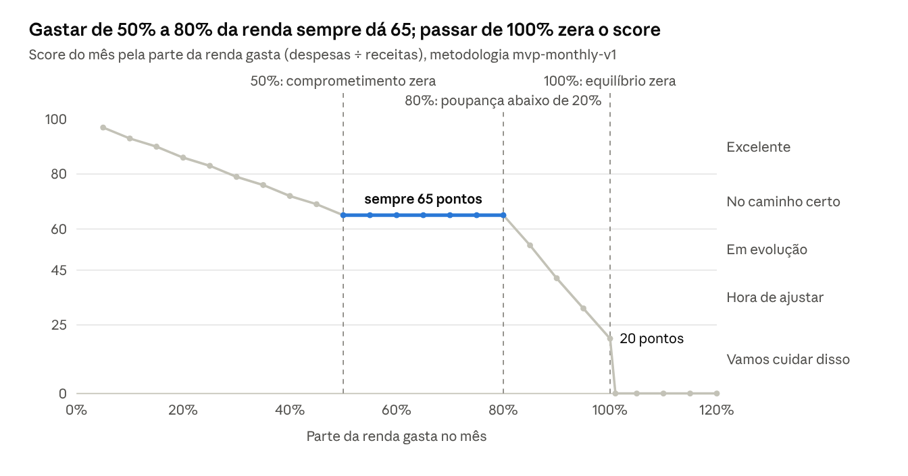

# Saúde Financeira — regra de negócio e fórmula

**Revisão:** 08/11/2026 · **Metodologia:** `mvp-monthly-v1` · **Cálculo:** `junta-ai-backend` → `DashboardService.calculateHealthScore` · **Exibição:** `frontend-v2` → `components/finance/FinancialHealthCard.jsx`, `hooks/useHealthScore.js`

O score vai de 0 a 100 e é calculado só para o mês corrente. Ele depende apenas de duas somas do mês: receitas (R) e despesas (D). O card avisa que é um "indicador educativo e simplificado", e não um score de crédito.

## Quando o score é calculado

- **Período:** apenas o mês civil corrente completo. Para outro intervalo, o backend devolve `healthScore = null` e o card mostra "Indisponível".
- **Dados mínimos:** precisa haver pelo menos uma receita e uma despesa no mês (R > 0 e D > 0). Sem isso, o status é `INSUFFICIENT_DATA`, o score fica vazio (nunca 50) e o card mostra "Em avaliação".
- **Conferência no front:** o card só exibe o score se as receitas, as despesas e o saldo devolvidos pelo `/dashboard` forem iguais, centavo a centavo, aos que a tela carregou. Se divergirem, nada é exibido.

## A ideia por trás do score

Imagine que o mês acabou e você quer saber, numa nota de 0 a 100, se cuidou bem do seu dinheiro. O Junta.ai responde isso fazendo três perguntas simples. Todas usam só dois números: quanto entrou no mês (as receitas, **R**) e quanto saiu (as despesas, **D**).

1. **Quanto sobrou?** Mede a poupança.
2. **Quanto da renda foi gasto?** Mede o comprometimento.
3. **O mês fechou no azul?** Mede o equilíbrio.

Cada resposta vira uma nota de 0 a 100, e a nota final é uma média dessas três notas, com pesos diferentes. Essa forma de medir não foi inventada aqui: o FinHealth Score, o índice de saúde financeira mais usado nos Estados Unidos, também dá uma nota de 0 a 100 para alguns indicadores simples e depois junta todos numa nota só ([Financial Health Network, 2021](https://finhealthnetwork.org/wp-content/uploads/2021/11/FinHealthScoreToolkit-2021.pdf)).

Para acompanhar o raciocínio, vamos seguir um exemplo do começo ao fim. **Em novembro, a Ana recebeu R$ 5.000,00 e gastou R$ 1.500,00.**

## Pergunta 1: quanto sobrou? (poupança, peso 45%)

**Por que perguntar isso.** Sobrar dinheiro todo mês é o que permite montar uma reserva, enfrentar imprevistos e realizar metas. Um estudo europeu sobre bem-estar financeiro, de Kempson, Finney e Poppe (2017), identificou "poupar ativamente" como um dos comportamentos que mais pesam no bem-estar financeiro das pessoas ([SIFO, 2017](https://www.bristol.ac.uk/media-library/sites/geography/pfrc/pfrc1705-financial-well-being-conceptual-model.pdf)).

**A conta.** Primeiro calculamos a *taxa de poupança* do mês, que é a parte da renda que sobrou:

```math
s = \frac{R - D}{R}
```

**Qual é a meta.** Usamos a meta da regra 50/30/20, do livro *All Your Worth*, de Elizabeth Warren e Amelia Warren Tyagi (2005): guardar **20%** da renda ([resenha](https://www.getrichslowly.org/book-review-all-your-worth/)). Vale saber que existe uma meta mais branda na literatura acadêmica: o estudo de Greninger e colegas (1996), feito com planejadores financeiros e professores da área, recomenda poupar pelo menos **10%** da renda ([Financial Services Review, Tabela 2, p. 67](https://openjournals.libs.uga.edu/fsr/article/download/3790/3237)). O Junta.ai escolheu a meta mais exigente.

**Como vira nota.** É uma regra de três: chegar na meta de 20% vale 100 pontos, e cada ponto percentual poupado vale 5 pontos. Passar da meta não dá nota extra, e sobra negativa vale 0.

```math
S = \min\left(100,\ \max\left(0,\ \frac{s}{0{,}20} \times 100\right)\right) = \min\left(100,\ \max\left(0,\ 500\,s\right)\right)
```

O 500 do código não é um número mágico: é apenas 100 ÷ 0,20.

| Sobrou da renda | 0% | 5% | 10% | 15% | 20% ou mais |
|---|---|---|---|---|---|
| Nota de poupança | 0 | 25 | 50 | 75 | 100 |

**Na prática, com a Ana:** sobraram R$ 3.500,00 de R$ 5.000,00, ou seja, 70% da renda. Como passou dos 20%, a nota de poupança dela é **100**.

## Pergunta 2: quanto da renda foi gasto? (comprometimento, peso 35%)

**Por que perguntar isso.** A primeira pergunta olha o que sobrou; esta olha o tamanho do que foi embora. Quem gasta uma fatia grande da renda todo mês fica sem folga: qualquer imprevisto vira aperto. Por isso os guias de orçamento trabalham com um teto para os gastos, e não só com uma meta de poupança.

**A conta.** Calculamos a parte da renda que foi gasta no mês:

```math
c = \frac{D}{R}
```

**Qual é o teto.** De novo a regra 50/30/20: no máximo **50%** da renda deve ir para as necessidades. Aqui há uma adaptação da equipe que precisa ficar clara. O livro aplica os 50% só aos gastos essenciais, e a primeira versão do Junta.ai fazia o mesmo, contando só Moradia, Transporte e Saúde. A versão atual aplica o teto a **todas** as despesas, porque o backend decidiu não depender dos nomes das categorias, que cada usuário pode mudar. O resultado é um critério mais exigente que o do livro.

**Como vira nota.** Funciona ao contrário da poupança: gastar nada vale 100, e cada ponto percentual gasto tira 2 pontos. Ao chegar em 50% da renda, a nota zera.

```math
C = \min\left(100,\ \max\left(0,\ 100 - \frac{c}{0{,}50} \times 100\right)\right) = \min\left(100,\ \max\left(0,\ 100 - 200\,c\right)\right)
```

O 200 do código é 100 ÷ 0,50.

| Gastou da renda | 0% | 10% | 20% | 30% | 40% | 50% ou mais |
|---|---|---|---|---|---|---|
| Nota de comprometimento | 100 | 80 | 60 | 40 | 20 | 0 |

**Na prática, com a Ana:** ela gastou R$ 1.500,00 de R$ 5.000,00, ou seja, 30% da renda. A nota de comprometimento dela é **40**.

**Um contraponto honesto.** Pelo estudo de Greninger e colegas (1996), gastar até 80% da renda líquida é considerado razoável, e o sinal de perigo só aparece em 90% ([p. 66](https://openjournals.libs.uga.edu/fsr/article/download/3790/3237)). Ou seja, os 30% da Ana são confortáveis por esse critério, e a nota 40 reflete a escolha da equipe por um teto rígido.

**Não confundir com o DTI.** Bancos usam o DTI (*debt-to-income*), que divide só as parcelas de dívidas pela renda; nos EUA, o limite para financiamento imobiliário é 43% ([CFPB, 2013](https://www.consumerfinance.gov/about-us/newsroom/cfpb-finalizes-april-clarifications-to-mortgage-rules)). O comprometimento do Junta.ai é outra medida, porque conta todas as despesas, e não só dívidas.

## Pergunta 3: o mês fechou no azul? (equilíbrio, peso 20%)

**Por que perguntar isso.** Esta é a regra mais básica de qualquer orçamento: não gastar mais do que entra. Quem fecha o mês no vermelho precisa cobrir a diferença com reservas, cartão ou empréstimo. Não por acaso, "gastar menos do que a renda" é o primeiro dos oito indicadores do FinHealth Score ([Financial Health Network, 2021](https://finhealthnetwork.org/wp-content/uploads/2021/11/FinHealthScoreToolkit-2021.pdf)), e "viver dentro das possibilidades" aparece entre os comportamentos centrais no estudo de Kempson, Finney e Poppe ([SIFO, 2017](https://www.bristol.ac.uk/media-library/sites/geography/pfrc/pfrc1705-financial-well-being-conceptual-model.pdf)).

**Como vira nota.** É uma pergunta de sim ou não: se o saldo do mês é zero ou positivo, a nota é 100; se é negativo, a nota é 0.

```math
E = \begin{cases} 100 & \text{se } R - D \ge 0 \\ 0 & \text{se } R - D < 0 \end{cases}
```

**Uma escolha da equipe.** No FinHealth Score essa pergunta tem cinco respostas possíveis, de "gastei muito menos que a renda" (100) a "gastei muito mais" (0). O Junta.ai usa só duas. O motivo não foi registrado, mas faz sentido: o quanto a pessoa ficou acima ou abaixo da renda já aparece nas perguntas 1 e 2. A primeira versão media a porcentagem de meses no azul; a atual olha só o mês corrente.

**Na prática, com a Ana:** ela fechou novembro com R$ 3.500,00 positivos, então a nota de equilíbrio é **100**.

## Juntando as respostas: a nota final

Pense numa prova com três questões que valem pesos diferentes. A nota final é a soma de cada nota multiplicada pelo seu peso:

```math
\text{Score} = \operatorname{arred}\left(0{,}45 \times S + 0{,}35 \times C + 0{,}20 \times E\right)
```

Os pesos somam 1 (45% + 35% + 20% = 100%), então a nota final também fica entre 0 e 100.

**A conta completa da Ana:**

| Pergunta | Nota | Peso | Pontos |
|---|---|---|---|
| Quanto sobrou? | 100 | 45% | 45 |
| Quanto foi gasto? | 40 | 35% | 14 |
| Fechou no azul? | 100 | 20% | 20 |
| **Score** | | | **79** |

Com 79, a Ana fica em **No caminho certo**, a um ponto de Excelente.

**De onde vêm os pesos.** Os pesos 45/35/20 são uma decisão da equipe, e não vêm de nenhum livro ou artigo. Isso é normal em índices desse tipo: o manual da OECD sobre como construir índices compostos afirma que pesos são sempre "juízos de valor" e podem ser definidos por especialistas ou pela equipe, desde que a escolha fique registrada ([Nardo et al., 2008](https://knowledge-for-policy.ec.europa.eu/sites/default/files/jrc47008_handbook_final.pdf)). O FinHealth Score, por exemplo, dá o mesmo peso a todos os seus indicadores. O projeto não registrou o motivo dos pesos do Junta.ai. Uma leitura possível, a confirmar pela equipe: poupar recebe mais peso porque é o que constrói segurança; o comprometimento vem em seguida porque mostra o quanto o orçamento está apertado; e o equilíbrio pesa menos porque é o mínimo esperado.

**As faixas.** A nota vira uma frase para o usuário:

| Score | O usuário vê | Cor |
|---|---|---|
| 80 a 100 | Excelente! Tudo tranquilo por aqui! | verde |
| 60 a 79 | No caminho certo | roxo |
| 45 a 59 | Em evolução | âmbar claro |
| 25 a 44 | Hora de ajustar | âmbar |
| 0 a 24 | Vamos cuidar disso | vermelho |

As faixas também são decisão de produto. A única coincidência com a literatura é o limite de 80: no FinHealth Score, quem tira de 80 a 100 é considerado financeiramente saudável.

**Mais dois exemplos.**

| Pessoa | Receitas | Despesas | Sobrou | Gastou | S | C | E | Score | Faixa |
|---|---|---|---|---|---|---|---|---|---|
| Ana | R$ 5.000,00 | R$ 1.500,00 | 70% | 30% | 100 | 40 | 100 | 79 | No caminho certo |
| Bruno | R$ 3.000,00 | R$ 2.700,00 | 10% | 90% | 50 | 0 | 100 | 43 | Hora de ajustar |
| Carla | R$ 2.000,00 | R$ 2.200,00 | −10% | 110% | 0 | 0 | 0 | 0 | Vamos cuidar disso |

O Bruno mostra bem as referências em jogo. Ele poupa 10%, o mínimo que Greninger e colegas consideram adequado, mas gasta 90% da renda, o ponto que o mesmo estudo chama de perigo. O score 43 diz a ele que há o que ajustar.

**Detalhe técnico.** As contas usam `BigDecimal` com 34 dígitos de precisão (`MathContext.DECIMAL128`, [Javadoc](https://javadoc.scijava.org/Java13/java.base/java/math/MathContext.html)), e a nota final é arredondada para inteiro com meio para cima: 42,5 vira 43.

## Como o score se comporta

Repare que as três perguntas dependem de um único número: a parte da renda que foi gasta (D ÷ R). Quem gasta 30% da renda fica com 70%, e o saldo dele é positivo. Por isso dá para desenhar o score inteiro numa curva só, que mostra três trechos:

- **Até 50% de gasto:** a poupança já está no máximo, e o score cai devagar, 0,7 ponto para cada ponto percentual gasto (de 100 até 65).
- **De 50% a 80%:** o comprometimento zerou e a poupança ainda está no máximo, então o score fica parado em **65**.
- **De 80% a 100%:** a poupança começa a cair, e o score desce rápido até 20. Passou de 100%, o mês fechou no vermelho e o score vai a **0**.



*Calculado com a fórmula do `DashboardService`, gasto de 5% a 120% da renda.*

## Por que dá para confiar nessa fórmula

O que o score mede e as metas que usa vêm da literatura de finanças pessoais. O jeito de pesar e rotular as notas é escolha da equipe, e cada escolha está registrada aqui.

| Parte da fórmula | No Junta.ai | De onde vem | Situação |
|---|---|---|---|
| Medir com notas de 0 a 100 e juntar numa média | 3 notas, 1 média ponderada | FinHealth Score ([2021](https://finhealthnetwork.org/wp-content/uploads/2021/11/FinHealthScoreToolkit-2021.pdf)); manual da OECD ([Nardo et al., 2008](https://knowledge-for-policy.ec.europa.eu/sites/default/files/jrc47008_handbook_final.pdf)) | Literatura |
| Dar nota pela distância até uma meta | Linha reta até a meta, travada entre 0 e 100 | Manual da OECD, seção 5.4 ("distância a uma referência") | Literatura |
| Meta de poupança | 20% da renda | Regra 50/30/20 ([Warren e Tyagi, 2005](https://www.getrichslowly.org/book-review-all-your-worth/)); Greninger et al. sugerem 10% ([1996](https://openjournals.libs.uga.edu/fsr/article/download/3790/3237)) | Literatura (a meta mais exigente) |
| Teto de gastos | 50% da renda, todas as despesas | Regra 50/30/20, que limita só as necessidades | Adaptação da equipe |
| Fechar o mês no azul | Sim (100) ou não (0) | FinHealth Score, indicador 1; Kempson et al. ([2017](https://www.bristol.ac.uk/media-library/sites/geography/pfrc/pfrc1705-financial-well-being-conceptual-model.pdf)) | Literatura, simplificada |
| Pesos | 45%, 35% e 20% | Nenhuma fonte; a OECD reconhece pesos como juízos de valor | Decisão da equipe |
| Faixas | 25, 45, 60 e 80 | Nenhuma fonte; o limite de 80 coincide com o FinHealth | Decisão da equipe |
| Período e dados mínimos | Mês corrente; exige receita e despesa | `junta-ai-backend/docs/health-score-mvp.md` | Decisão da equipe |

## Origem da fórmula e decisões do projeto

A fórmula nasceu no frontend e foi levada para o backend um mês depois. Nenhuma das duas versões citava fonte; as referências acima foram levantadas depois, para fundamentar o que já estava implementado.

| Data | Autora | O que aconteceu |
|---|---|---|
| 20/10/2026 | Danieli Dutra Braga ([161e5bc](https://github.com/Junta-ai-br/junta-ai-backend/commit/161e5bc)) | Levou o cálculo para o backend como `mvp-monthly-v1`, olhando só o mês corrente. Passou a contar todas as despesas no comprometimento e transformou o equilíbrio em sim ou não. Manteve os pesos e as metas. |
| 11/09/2026 | Thais Rodrigues ([b624a12](https://github.com/Junta-ai-br/junta-ai/commit/b624a12)) | Criou a primeira versão no frontend: média da taxa de poupança dos meses com meta de 20%, gastos fixos (Moradia, Transporte, Saúde) com teto de 50%, e porcentagem de meses no azul. Pesos 45/35/20. |

As decisões abaixo estão registradas em `junta-ai-backend/docs/health-score-mvp.md`, com data de 20/10/2026. As regras de período, dados mínimos e conferência no front estão em [Quando o score é calculado](#quando-o-score-é-calculado).

1. **É um indicador educativo.** Não é score de crédito nem diagnóstico profissional, e o card diz isso ao usuário.
2. **Só conta o que foi registrado.** Usa as somas de receitas e despesas gravadas no banco. Não usa nomes de categorias, frequência de uso nem lançamentos planejados.
3. **Um só lugar calcula.** O backend calcula e entrega o mesmo resultado ao card e à IA, para o chat e a tela nunca mostrarem notas diferentes. O front não tem nenhuma aritmética de score.
4. **Nada é guardado.** O score não fica salvo no banco, e não existe histórico ou evolução simulada.
5. **A metodologia tem nome e versão.** Toda resposta traz `mvp-monthly-v1`, e o front recusa uma metodologia que não conhece. Uma fórmula nova deve ganhar outro nome.

## Testes, escala e ponto de atenção no código

- **Testes:** `DashboardServiceTest` (backend) cobre o cálculo do score, inclusive a ausência de nota fora do mês corrente. O card é testado em `components/finance`.
- **Escala:** o score usa duas somas feitas no PostgreSQL com o índice `(user_id, transaction_date)`; o custo não cresce com o número de lançamentos exibidos.
- **Fuso horário do mês:** o score usa o mês em UTC no backend, enquanto o front usa a data local do navegador. No último dia do mês, a partir das 21h no horário de Brasília, o backend já está no mês seguinte e o card mostra "Indisponível" até a meia-noite.

## O que ainda pode melhorar

A própria literatura aponta onde a fórmula pode evoluir. Nenhum destes pontos é um erro do código; são efeitos das escolhas atuais, com uma sugestão de caminho.

1. **Duas perguntas olham o mesmo número.** Poupança e comprometimento dependem ambos de D ÷ R. O manual da OECD alerta que indicadores correlacionados contam a mesma informação duas vezes, e é isso que cria o patamar em 65. *Caminho:* voltar a medir o comprometimento só com gastos essenciais, como na primeira versão e na regra 50/30/20. Para isso, as categorias precisariam ser marcadas como essenciais ou não.
2. **O equilíbrio muda de 100 para 0 de uma vez.** Gastar um centavo a mais que a renda derruba o score de 20 para 0. *Caminho:* usar níveis intermediários, como os cinco do FinHealth Score.
3. **As metas são mais rígidas que as da pesquisa acadêmica.** Greninger e colegas consideram adequado poupar 10% e razoável gastar até 80% da renda. *Caminho:* a equipe pode manter as metas da regra 50/30/20 de propósito, mas vale registrar essa escolha.
4. **O score não olha a reserva de emergência.** Greninger e colegas recomendam ter pelo menos 2,5 meses de despesas guardados, e o FinHealth tem um indicador só para isso. *Caminho:* o Junta.ai já sabe quanto está no Guardado e poderia usar esse valor numa versão futura.
5. **O motivo dos pesos não está escrito.** *Caminho:* registrar a justificativa da equipe em `docs/health-score-mvp.md`, ou testar pesos iguais, como faz o FinHealth.

Qualquer uma dessas mudanças cria uma metodologia nova, que deve ganhar outro nome (por exemplo, `mvp-monthly-v2`).

## Fontes da fórmula

- WARREN, Elizabeth; TYAGI, Amelia Warren. *All Your Worth: The Ultimate Lifetime Money Plan*. Free Press, 2005. Regra 50/30/20 ([resenha](https://www.getrichslowly.org/book-review-all-your-worth/)).
- GRENINGER, S. A.; HAMPTON, V. L.; KITT, K. A.; ACHACOSO, J. A. Ratios and Benchmarks for Measuring the Financial Well-Being of Families and Individuals. *Financial Services Review*, v. 5, n. 1, p. 57–70, 1996 ([artigo](https://openjournals.libs.uga.edu/fsr/article/download/3790/3237)).
- FINANCIAL HEALTH NETWORK. *FinHealth Score Toolkit*. Chicago, 2021 ([PDF](https://finhealthnetwork.org/wp-content/uploads/2021/11/FinHealthScoreToolkit-2021.pdf)).
- KEMPSON, E.; FINNEY, A.; POPPE, C. *Financial Well-Being: A Conceptual Model and Preliminary Analysis*. SIFO Project Note 3-2017. Oslo: Consumption Research Norway, 2017 ([PDF](https://www.bristol.ac.uk/media-library/sites/geography/pfrc/pfrc1705-financial-well-being-conceptual-model.pdf)).
- NARDO, M.; SAISANA, M.; SALTELLI, A.; TARANTOLA, S.; HOFFMANN, A.; GIOVANNINI, E. *Handbook on Constructing Composite Indicators: Methodology and User Guide*. Paris: OECD Publishing, 2008 ([PDF](https://knowledge-for-policy.ec.europa.eu/sites/default/files/jrc47008_handbook_final.pdf)).
- CONSUMER FINANCIAL PROTECTION BUREAU. *CFPB finalizes April clarifications to mortgage rules*. 10 jul. 2013 ([página](https://www.consumerfinance.gov/about-us/newsroom/cfpb-finalizes-april-clarifications-to-mortgage-rules)).
- ORACLE. *Java SE API: java.math.MathContext* ([Javadoc](https://javadoc.scijava.org/Java13/java.base/java/math/MathContext.html)).
- Junta.ai: `junta-ai-backend/docs/health-score-mvp.md`, `DashboardService.calculateHealthScore` e os commits [b624a12](https://github.com/Junta-ai-br/junta-ai/commit/b624a12) e [161e5bc](https://github.com/Junta-ai-br/junta-ai-backend/commit/161e5bc).

[Voltar ao índice técnico](tecnico-visao-geral.md).
