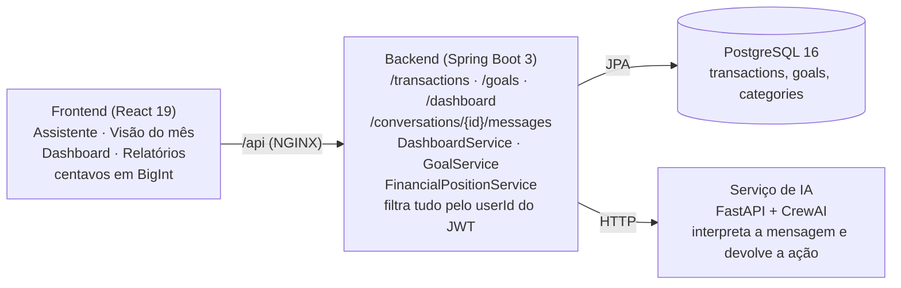

# Documentação técnica — visão geral

**Revisão:** 08/11/2026 · **Autora:** Thais Rodrigues · **Base:** `main` em 06/11/2026 (`junta-ai` 0ca4f30, `junta-ai-backend` 09de58e).

Este é o índice da documentação técnica das telas de finanças do Junta.ai. Aqui ficam só os pontos comuns a todas as features: arquitetura, tecnologias, decisões transversais e organização do código. Regras de negócio, decisões específicas, testes e escala de cada feature estão no arquivo dela.

## 1. Features documentadas

As telas autenticadas de finanças leem os mesmos lançamentos do usuário e só mostram números quando o período foi carregado por completo.

| Feature | Rota | Arquivo principal | Documento técnico |
|---|---|---|---|
| Assistente | `/assistente` | `pages/Assistente/Assistente.jsx` | [tecnico-assistente.md](tecnico-assistente.md) |
| Saúde Financeira | card no Assistente | `components/finance/FinancialHealthCard.jsx` + `DashboardService` | [tecnico-saude-financeira.md](tecnico-saude-financeira.md) |
| Metas e Guardado | cards no Assistente e no Dashboard | `components/finance/GoalsCard.jsx`, `SavedCard.jsx` + `GoalService` | [tecnico-metas-e-guardado.md](tecnico-metas-e-guardado.md) |
| Visão do mês e Dashboard | `/visao-mes`, `/dashboard` | `pages/VisaoMes/VisaoMes.jsx`, `pages/Dashboard/Dashboard.jsx` | [tecnico-visao-do-mes-e-dashboard.md](tecnico-visao-do-mes-e-dashboard.md) |
| Relatórios | `/relatorios` | `pages/Relatorios/Relatorios.jsx` | [tecnico-relatorios.md](tecnico-relatorios.md) |

Os caminhos do frontend são relativos a `junta-ai/frontend-v2/src`; os serviços citados ficam no `junta-ai-backend`.

## 2. Arquitetura e fluxo de dados

O navegador só conversa com o backend. O backend soma os lançamentos no banco, calcula o score e chama a IA quando chega uma mensagem do chat.

## 3. Tecnologias

| Camada | Tecnologia | Uso nestas features |
|---|---|---|
| Frontend | React 19 + Vite 8 | Componentes das telas; build estático servido por NGINX |
| Frontend | React Router 7 | Rotas `/assistente`, `/visao-mes`, `/dashboard` e `/relatorios`, todas atrás de `ProtectedRoute` |
| Frontend | Recharts 3 | Gráficos de categorias, evolução mensal, entradas e saídas e semanas |
| Frontend | Radix UI (Dialog) | Modais acessíveis de criar, editar e excluir lançamentos e categorias |
| Frontend | Axios | Cliente HTTP com token Bearer, cancelamento por `AbortController` e validação de contrato |
| Frontend | lucide-react | Ícones dos cards |
| Frontend | BigInt nativo do JavaScript | Dinheiro em centavos exatos (`signed-money.js`, `exact-aggregates.js`) |
| Frontend | Vitest + Testing Library | Testes de unidade, componente e integração |
| Backend | Java 21 + Spring Boot 3.3 | API REST: `/dashboard`, `/transactions`, `/categories`, `/goals`, `/conversations` |
| Backend | Spring Data JPA + `BigDecimal` | Somas no banco e cálculos monetários exatos |
| Backend | Spring Security + JWT | Cada consulta é filtrada pelo `userId` do token |
| Backend | Flyway | Migrations V1 a V12 |
| Dados | PostgreSQL 16 | Valores em `NUMERIC(19,2)` com `CHECK (amount > 0)`; índice `(user_id, transaction_date)` |
| IA | FastAPI + CrewAI | Interpreta mensagens do chat e devolve ações que o backend executa |
| Infra local | Docker Compose + NGINX | Quatro containers; o NGINX serve o front e repassa `/api` ao backend |

## 4. Decisões técnicas comuns

A decisão central é nunca mostrar um número financeiro que possa estar errado: na dúvida, a tela mostra "Indisponível".

| Decisão | Por quê | Onde |
|---|---|---|
| Dinheiro como texto decimal e centavos em `BigInt` | `0,1 + 0,2` em ponto flutuante não dá 0,3; centavos inteiros não perdem precisão | `signed-money.js`, `exact-aggregates.js` |
| JSON do `/dashboard` decodificado sem passar valores por `Number` | Evita arredondar valores grandes ao ler a resposta | `decodeDashboard` |
| Exibição só com cobertura completa do período | Um total parcial parece certo e engana; melhor não mostrar | `financial-loader.js`, `coverage.complete` |
| Dados ligados à sessão (`generation`) | Após logout ou troca de usuário, respostas antigas são descartadas | `useHealthScore`, `useGoals`, `useSaved` |
| Contratos validados | Toda resposta da API passa por um `validate` antes de virar estado; um campo inesperado vira erro visível, e não um número errado | `services/*.api.js`, `resource-http.js` |
| Backend como autoridade | O front repete algumas validações só para avisar mais cedo; as regras valem no backend | `junta-ai-backend/service` |

## 5. Organização do código

- **Telas finas, serviços puros.** As páginas montam a interface. O cálculo fica em funções sem estado (`exact-aggregates.js`, `report-utils.js`, `signed-money.js`), fáceis de testar.
- **Hooks por domínio.** `useGoals`, `useSaved`, `useHealthScore` e `useCanonicalFinance` concentram carga, cancelamento e sessão. Um card novo reaproveita o hook, sem repetir a lógica.
- **Testes compartilhados.** As camadas usadas por todas as telas têm 163 casos: `services/finance` (9 arquivos, 102 casos), `components/finance` (5 arquivos, 44 casos) e `hooks` (4 arquivos, 17 casos). Rodam com `npm run test:run` em `frontend-v2`. Os testes de cada tela estão no documento da feature.

## 6. Referências

- Código: `junta-ai/frontend-v2/src` e `junta-ai-backend/src/main/java/br/com/juntaai`.
- Documento interno: `junta-ai-internal/docs/ai/health-score.md` (AI-009).

[Voltar ao índice de funcionalidades](README.md).
